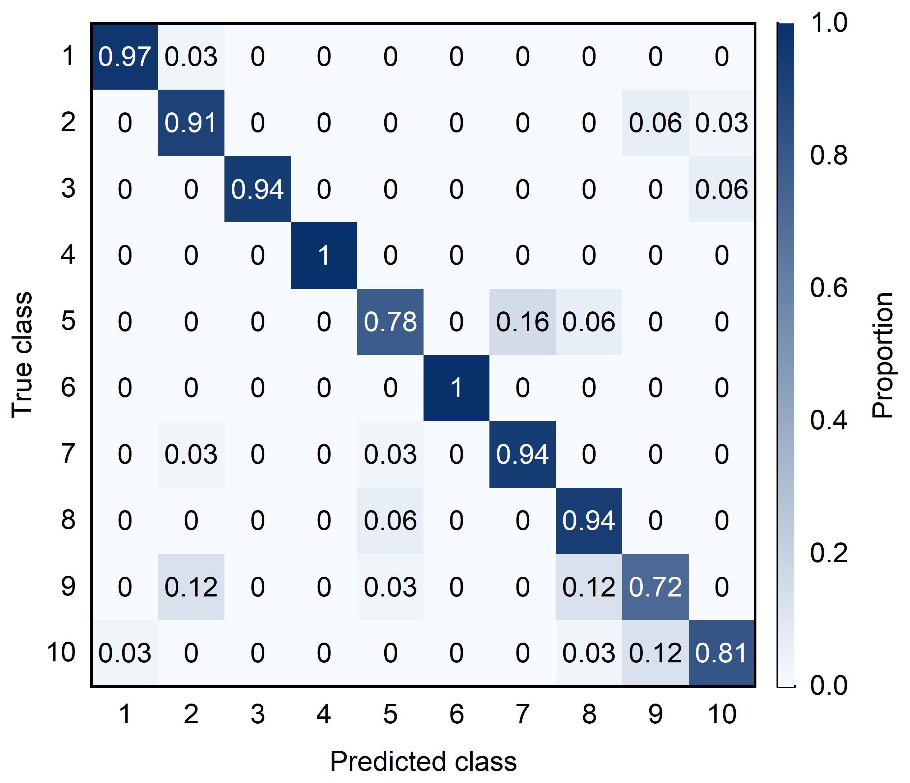
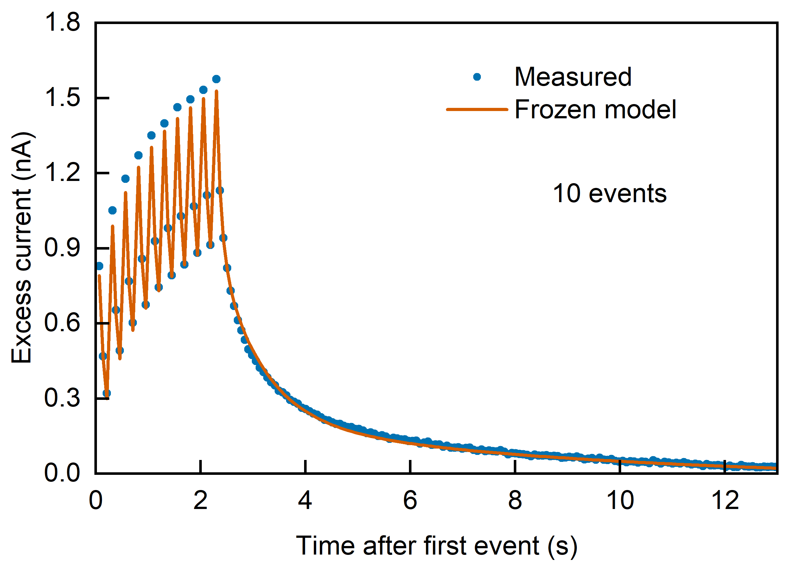
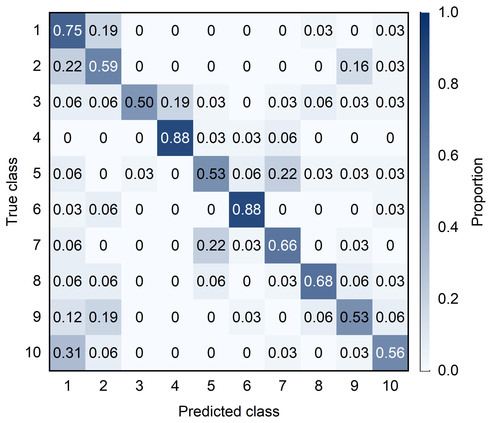

# Origin Scientific Plotting

A reusable **Codex skill for scientific plotting through the installed Origin application on Windows**. It creates native editable `.opju` projects, exports vector figures, checks saved numbers and typography, and can embed graphs in PowerPoint as editable Origin OLE objects.

[中文首页](README.md) · [中文使用指南](docs/中文使用指南.md) · [Nature / Science / Cell plotting guide (Chinese)](docs/CNS期刊风格与选图指南.md)

The repository includes synthetic practice examples and a separately sourced [research gallery](docs/research-gallery/README.md): author-released EPSC traces and existing ten-action, device-model RC simulation outputs. Each example identifies its source and scope. Phone/watch recordings and proprietary Origin software are not included.

## EPSC and ten-action RC research gallery



Seven native Origin figures cover light/dark ten-action confusion matrices, a measured ten-event response, paired forty-event model accumulation, a logarithmic hundred-event recovery diagnostic, a 40 × 150 reservoir-current map, and a historical recovery-deviation comparison. [Download PNG, vector PDF/EMF and editable OPJU](docs/research-gallery/README.md), or reproduce them from [frozen data/specifications](examples/research-gallery/figures.json).

The confusion matrices use 319 public UTD-MHAD out-of-fold predictions from eight held-out subjects, the fixed device models and a Softmax readout with shared 2-bit quantization. These are model-driven simulations. The hundred-event traces expose a slow-recovery mismatch; the historical L3/C3 comparison is explicitly separate from the final RC model. Plotting did not refit models or rerun classifiers.

## Journal guidance and a native Origin gallery

The [Chinese guide](docs/CNS期刊风格与选图指南.md) separates exact-journal requirements from practical plot-selection advice, with dated primary-source links, unresolved official-source conflicts, and final-size font calculations. Cell-specific numbers remain unverified rather than being inferred from Elsevier's general artwork guide. These are independent recommendations, not certified journal templates.

The [four native examples](docs/journal-gallery/README.md) include time response, individual observations, paired observations and a normalized confusion matrix with an untested class. Synthetic data/specifications, editable OPJU projects, native vector PDFs and numerical/layout verification summaries are public. The Skill routes journal-style requests to its new `references/journal-style.md` reference. Sources were checked on **2026-10-09**; verify current target-journal instructions when submitting.

## What it does

- Native Origin line, scatter, symmetric error-bar, column, and annotated heatmap plots.
- Explicit row normalization for confusion matrices, preserving original counts and missing/untested rows.
- Native `.opju`, `.png`, `.pdf`, `.emf` exports; `.svg` converted from Origin's vector PDF.
- Compact native pages, configurable fonts/frame dimensions, and saved-project numerical/layout verification.
- Optional PowerPoint output with embedded Origin graphs, locked aspect ratios, configurable placement width, and captions.

The code draws supplied data. It does not fit, smooth, select observations, train classifiers, or create scientific measurements. Visual inspection remains required after automated checks.

## Requirements

- Windows with installed, licensed Origin and working `Origin.Application` COM registration.
- Python 3.10+ and the packages in the skill's `requirements.txt`.
- Microsoft PowerPoint desktop is required **only** for editable PPT output.

Basic workflows were exercised with OriginPro 2021 (internal version 9.8002) on Windows. Compatibility with other versions, fonts, locales, and complex graph types must be checked in the target environment. Linux/macOS can validate specifications but cannot run native Origin COM plotting. See [validation scope](docs/VALIDATION.md).

## Install in Codex

Ask Codex, with the skill installer available:

> Install the skill from https://github.com/jiahehu2000-lgtm/origin-scientific-plotting, path `skills/origin-scientific-plotting`.

Or clone and copy the **skill folder**, not the entire repository:

```powershell
git clone https://github.com/jiahehu2000-lgtm/origin-scientific-plotting.git
$originSkill = Join-Path $HOME '.codex/skills/origin-scientific-plotting'
if (Test-Path -LiteralPath $originSkill) { throw 'Skill already exists; inspect it before replacing.' }
New-Item -ItemType Directory -Path (Split-Path -Parent $originSkill) -Force | Out-Null
Copy-Item -LiteralPath './origin-scientific-plotting/skills/origin-scientific-plotting' -Destination $originSkill -Recurse
```

Start a new Codex conversation if the skill does not appear in the current session. Then invoke:

Alternatively, download the skill ZIP from [Releases](https://github.com/jiahehu2000-lgtm/origin-scientific-plotting/releases/latest), extract it, and place the included `origin-scientific-plotting` folder under `~/.codex/skills/`. Dependencies still need to be installed. Use the full repository to obtain the runnable synthetic examples.

> Use `$origin-scientific-plotting` to plot this CSV in Origin. Match my reference figure, export an editable OPJU and vector PDF, and check the final layout.

For editable PPT:

> Use `$origin-scientific-plotting` to put these Origin graphs into PowerPoint as embedded objects that open Origin when double-clicked. Set the graph width to 5 cm, lock aspect ratios, and add Chinese captions.

## Run the examples without Codex

From the repository root, use a virtual environment:

```powershell
python -m venv .venv
& ./.venv/Scripts/python.exe -m pip install -r skills/origin-scientific-plotting/requirements.txt
& ./.venv/Scripts/python.exe skills/origin-scientific-plotting/scripts/origin_plot.py --doctor
& ./.venv/Scripts/python.exe skills/origin-scientific-plotting/scripts/origin_plot.py --spec examples/figures.json --validate-only
& ./.venv/Scripts/python.exe skills/origin-scientific-plotting/scripts/origin_plot.py --spec examples/figures.json --output results
& ./.venv/Scripts/python.exe skills/origin-scientific-plotting/scripts/origin_to_ppt.py --manifest results/manifest.json --output example_figures.pptx --width-cm 5
```

`results` must be new or empty; an existing PPTX is never overwritten. To append to a copy of a deck, add `--template existing.pptx` and select a new output filename. The PowerPoint helper uses the Windows clipboard while embedding graphs; avoid copying other content during that short operation.

Edit [examples/figures.json](examples/figures.json) for your own data. Read the [specification reference](skills/origin-scientific-plotting/references/figure-spec.md), [native Origin workflow](skills/origin-scientific-plotting/references/origin-workflow.md), and [editable PPT workflow](skills/origin-scientific-plotting/references/powerpoint-ole.md) for limits and implementation details.

## Output structure

```text
results/
  manifest.json                 Complete only when every figure passes
  origin_commands.json          Executed native commands
  01_response/
    01_response.opju            Editable Origin project with numerical data
    01_response.png
    01_response.pdf
    01_response.emf
    01_response.svg             Derived from the Origin PDF
    Data001.csv                 Numerical table used by the native graph
    frozen_spec.json
    verification.json
  04_confusion/
    original_matrix.csv         Original supplied counts
    Matrix01.csv                Normalized displayed values, missing cells blank
    ...
```

Failure reports preserve diagnostics and do not become a complete manifest. Reports contain source paths/hashes; review them before publishing your outputs. An `interactive_editing_tested: false` result means structural OLE checks passed but the helper did not test opening the embedded editor.

## Preview

These previews are created in Origin from the supplied frozen research data. Synthetic practice examples remain available separately in `examples/figures.json` and `examples/journal-gallery/figures.json`.





## Development checks

```powershell
python -m pip install -r requirements-dev.txt
python -m unittest discover -s tests -v
python scripts/validate_skill.py
```

GitHub Actions runs portable metadata/specification tests. Native Origin and Office tests require a licensed Windows desktop and are not run on hosted CI. [Validation scope](docs/VALIDATION.md) distinguishes the two.

## 中文使用说明

这是一个通过 **Windows 本机 Origin** 进行科研绘图的 Codex skill。可以绘制曲线、散点、误差棒、柱状图和带数值标注的混淆矩阵，并导出可编辑 Origin 工程、PDF/EMF 矢量图。SVG 由 Origin 导出的 PDF 转换而来。

安装方式：把仓库内 `skills/origin-scientific-plotting` 整个文件夹放到 `~/.codex/skills/`，然后在新会话中使用 `$origin-scientific-plotting`。Python 依赖按上面的命令安装，Origin 需自行安装并持有可用许可。

也可以从 [Releases](https://github.com/jiahehu2000-lgtm/origin-scientific-plotting/releases/latest) 下载 skill ZIP，解压后将同名文件夹放到上述目录。完整可运行示例在本仓库中。

示例指令：

> 使用 `$origin-scientific-plotting`，调用 Origin 绘制这些科研数据，参考我提供的图片统一字体字号、边框和比例，去掉多余白边，导出 OPJU、PDF 和 EMF。

> 使用 `$origin-scientific-plotting`，把这些图作为可双击打开 Origin 的嵌入对象放入 PPT，宽度设为 5 cm，锁定长宽比例，添加中文备注。

字号、颜色、图框和 PPT 宽度均可配置。默认设置是演示值，不是通用期刊标准。绘图脚本保留原始数值；混淆矩阵归一化需明确开启，未测试行显示为缺失。自动核验后仍需查看图片，确认最终尺寸下没有文字重叠或裁切。

## License

MIT for this repository's code and skill content. Origin and Microsoft Office are separately licensed products. This project is independent and is not an official OriginLab or OpenAI product.
