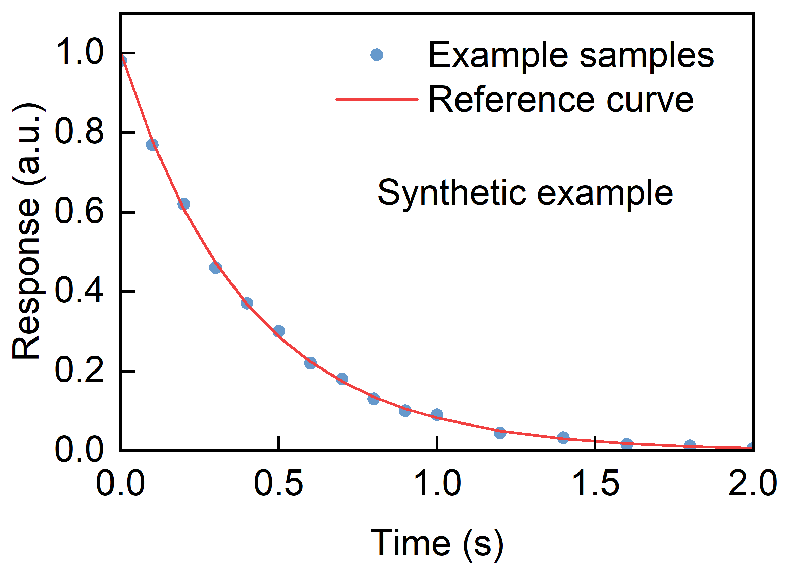
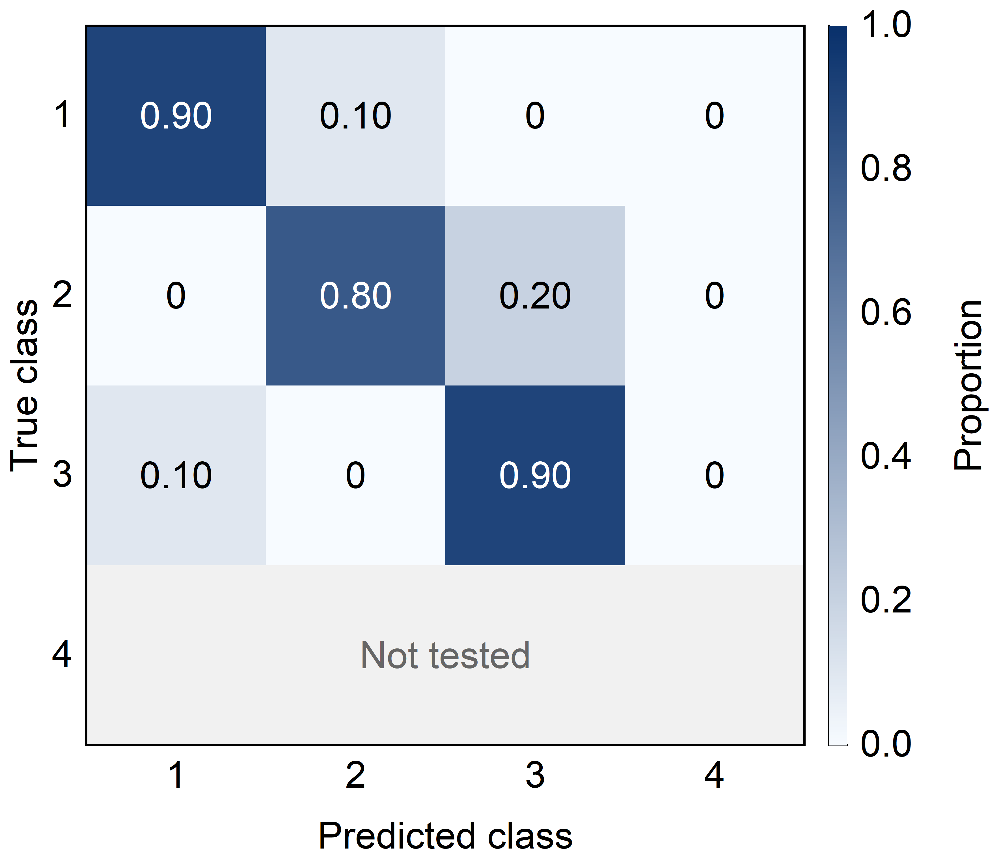

# Origin Scientific Plotting｜让 Codex 调用 Origin 画科研图

[](https://github.com/jiahehu2000-lgtm/origin-scientific-plotting/actions/workflows/validate.yml)
[](LICENSE)
[](#使用条件)
[](https://github.com/jiahehu2000-lgtm/origin-scientific-plotting/stargazers)

**把科研数据交给 Codex，用本机 Origin 绘图，拿到可编辑工程、矢量图，以及能双击回 Origin 的 PPT。**


[中文使用指南](docs/中文使用指南.md) · [Nature / Science / Cell 选图指南](docs/CNS期刊风格与选图指南.md) · [English](README.en.md) · [下载 Skill v0.2.0](https://github.com/jiahehu2000-lgtm/origin-scientific-plotting/raw/refs/heads/main/dist/origin-scientific-plotting-skill-v0.2.0.zip) · [真实验证范围](docs/VALIDATION.md)

如果这个工具能帮你整理论文图，欢迎点一个 **⭐ Star**，方便下次找到。使用问题和参考图适配需求可以提交 [Issue](https://github.com/jiahehu2000-lgtm/origin-scientific-plotting/issues)。

## 先看实际输出

下列示例使用仓库中的**合成演示数据，由 Origin 原生绘制并导出**。你的原始数据不会因为绘图被拟合、平滑或筛选。

<table>
  <tr>
    <td width="50%"></td>
    <td width="50%"></td>
  </tr>
  <tr>
    <td align="center">曲线 / 散点：统一字体、图框与图例</td>
    <td align="center">混淆矩阵：每格标值，保留未测试状态</td>
  </tr>
</table>

| 你需要什么 | 可以得到什么 |
|---|---|
| 后面还要改图 | 原生 `.opju` 工程，包含绘图数据与图形 |
| 放进论文或排版软件 | Origin 导出的 PDF、EMF 矢量图与 PNG 预览；SVG 由矢量 PDF 转换 |
| 放进组会 PPT 后继续编辑 | 嵌入式 Origin OLE 对象，设定宽度并锁定比例；双击调用 Origin 编辑 |
| 多张图风格统一 | 可配置字体、字号、图框尺寸、颜色和页边距，并核验保存后的设置 |

已提供曲线、散点、**对称误差棒**、柱状图及带数值标注的热图。复杂多层图、组合图和特殊图型需进一步适配，详见[验证范围](docs/VALIDATION.md)。

## 新增：Nature / Science / Cell 科研选图指南

**什么数据画什么图？怎样统一字号，又避免把“期刊风格”误当官方要求？**

[中文指南](docs/CNS期刊风格与选图指南.md)整理了官方来源核验、按数据关系选图的决策表、最终宽度与字号换算，以及 Origin 的实际操作边界。Nature、Nature Communications、Science 和 Science Advances 分开列出；Cell 当前官方页面未能读取，未知参数及官方来源冲突均保留。资料核验于 **2026-10-09**。


四张图全部由 Origin 原生绘制，提供 [PNG / 矢量 PDF / 可编辑 OPJU](docs/journal-gallery/README.md)、[公开合成数据与设置](examples/journal-gallery/figures.json)和核验摘要。它们是选图和排版示例，不是期刊认证模板。新版 Skill 会在请求期刊风格或选图建议时读取这些规则。

## 三步开始

### 1. 准备环境

- Windows，本机已安装且具有可用许可的 Origin，能够调用 `Origin.Application` COM。
- Python 3.10+，安装 Skill 的 Python 依赖。
- 需要可编辑 PPT 时，再准备 Microsoft PowerPoint 桌面版。

### 2. 安装 Skill

在有 Skill 安装功能的 Codex 中发送：

> 从 https://github.com/jiahehu2000-lgtm/origin-scientific-plotting 安装 Skill，路径是 `skills/origin-scientific-plotting`。

也可直接下载 [v0.2.0 Skill ZIP](https://github.com/jiahehu2000-lgtm/origin-scientific-plotting/raw/refs/heads/main/dist/origin-scientific-plotting-skill-v0.2.0.zip)，将其中的 `origin-scientific-plotting` 文件夹放到 `~/.codex/skills/`。依赖仍需安装；完整步骤见[中文指南](docs/中文使用指南.md)，版本说明见 [Releases](https://github.com/jiahehu2000-lgtm/origin-scientific-plotting/releases/latest)。

### 3. 给数据和要求

> 使用 `$origin-scientific-plotting`，调用 Origin 绘制这个 CSV。X 轴是时间，Y 轴是电流。参考我附的图片统一字体字号和边框，缩小多余白边，导出可编辑 OPJU、PDF 和 EMF，并检查文字有没有重叠或裁切。

要做可编辑 PPT，可以接着说：

> 把这些 Origin 图作为嵌入对象放到 PPT，要求双击能打开 Origin；每张宽度 5 cm，锁定长宽比例，添加中文说明。

## 不用 Codex，也能直接运行

克隆仓库后，在仓库根目录运行：

```powershell
python -m venv .venv
& ./.venv/Scripts/python.exe -m pip install -r skills/origin-scientific-plotting/requirements.txt

# 检查本机环境，以及演示数据的格式
& ./.venv/Scripts/python.exe skills/origin-scientific-plotting/scripts/origin_plot.py --doctor
& ./.venv/Scripts/python.exe skills/origin-scientific-plotting/scripts/origin_plot.py --spec examples/figures.json --validate-only

# 调用 Origin，生成四张演示图及原生工程
& ./.venv/Scripts/python.exe skills/origin-scientific-plotting/scripts/origin_plot.py --spec examples/figures.json --output results

# 可选：把图嵌入 PPT，每张宽度 5 cm
& ./.venv/Scripts/python.exe skills/origin-scientific-plotting/scripts/origin_to_ppt.py --manifest results/manifest.json --output example_figures.pptx --width-cm 5
```

`results` 必须是新目录或空目录；已有 PPTX 不会被覆盖。需要添加到原有 PPT 时，用 `--template existing.pptx` 并指定新的输出文件名。嵌入过程中会短暂使用 Windows 剪贴板。

自己的数据从 [examples/figures.json](examples/figures.json) 改起。各字段、表格列名及矩阵格式见[绘图规格](skills/origin-scientific-plotting/references/figure-spec.md)。

## 输出里面有什么

```text
results/
  manifest.json              批次状态、导出文件及核验信息
  origin_commands.json       执行过的 Origin 指令
  01_response/
    01_response.opju         可编辑工程
    01_response.pdf / .emf   Origin 矢量导出
    01_response.svg          从 Origin PDF 转换
    01_response.png          预览
    Data001.csv              实际绘图数据
    frozen_spec.json         本次绘图设置
    verification.json        数据与版式核验
```

混淆矩阵还保存原始计数和显示矩阵。归一化须明确开启；未测试行保留为缺失。核验记录会包含来源路径和哈希，分享结果前请自行查看。

## 使用条件

本地验证使用 OriginPro 2021 和 PowerPoint 16.0；其他版本、字体和复杂图型需要在你的环境中确认。GitHub 自动检查验证的是规格、元数据与可移植逻辑，**不会在云端运行 Origin 或 Office**。

自动核验后仍需要查看最终尺寸下的图片。`interactive_editing_tested: false` 表示嵌入对象结构已检查，但脚本没有自动双击测试编辑器。详细证据见 [VALIDATION.md](docs/VALIDATION.md)。

## 相关开源项目

[PhotoSynapse-RC](https://github.com/jiahehu2000-lgtm/photo-synapse-rc)：器件模型驱动的储备池计算，提供中文图解、光暗模型和可复现分类流程。两个仓库可分别使用；RC 结果需要按绘图规格准备后交给本工具绘制。

## 参与与许可

欢迎提交脱敏的小数据样例、报错信息或希望适配的图型。开发检查：

```text
python -m pip install -r requirements-dev.txt
python -m unittest discover -s tests -v
python scripts/validate_skill.py
```

本仓库代码与 Skill 内容使用 [MIT 许可](LICENSE)。Origin 和 Microsoft Office 是需另行许可的软件；本项目由作者独立维护。
