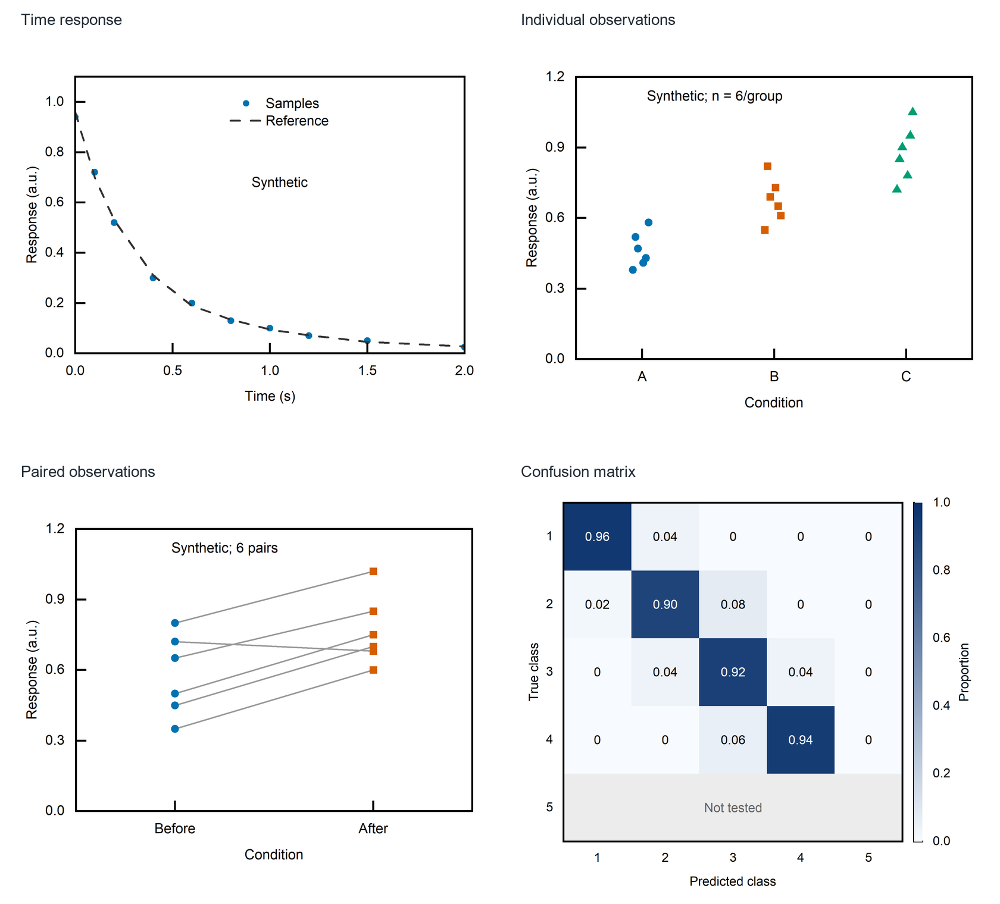

# 四种数据关系的 Origin 原生示例

**全部是公开合成数据，用真实 Origin 原生绘制。** 可下载 PNG、矢量 PDF 和可编辑 OPJU；这些图说明选图与排版思路，不是 Nature、Science 或 Cell 的认证模板。

[期刊规格与选图指南](../CNS期刊风格与选图指南.md) · [数据与绘图设置](../../examples/journal-gallery/figures.json) · [核验摘要和文件哈希](validation.json)



| 示例 | 表达的关系 | 下载 | PDF 实际尺寸（mm） |
|---|---|---|---|
| 01 时间响应 | 样本点与已提供的参考曲线；未进行拟合 | [PNG](01_time_response.png) · [PDF](01_time_response.pdf) · [OPJU](01_time_response.opju) | 82.903 × 61.736 |
| 02 个体观测 | A/B/C 三组，每组六个独立合成观测；显示全部点 | [PNG](02_individual_points.png) · [PDF](02_individual_points.pdf) · [OPJU](02_individual_points.opju) | 81.492 × 62.089 |
| 03 配对观测 | 六对前后测量，连线保留同一观测的对应关系 | [PNG](03_paired_observations.png) · [PDF](03_paired_observations.pdf) · [OPJU](03_paired_observations.opju) | 81.492 × 62.089 |
| 04 混淆矩阵 | 每个已测试真实类别 50 条，行归一化；第 5 类未测试而非识别率为零 | [PNG](04_confusion_matrix.png) · [PDF](04_confusion_matrix.pdf) · [OPJU](04_confusion_matrix.opju) | 87.842 × 77.611 |

归一化矩阵的原始计数保存在绘图设置中，复现时另输出 `original_matrix.csv`。不要把灰色未测试行改成实测零值，也不要因某些预测类别没有观测就删除它们。

## 实际检查了什么？

2026-10-09，在 Windows 的 OriginPro 2021（内部版本 9.8002）中绘制四图，保存后重新打开 OPJU，比较了全部数值、坐标和字号。原生设置为 Arial、7 pt；页面在 Origin 中收紧，保留物理图框与文字大小。

四份 PDF 均为一页，包含矢量路径、可提取的 ArialMT 文字，未嵌入整张位图。PDF 中实际文字约为 **6.958–6.959 pt**，与原生 7 pt 的微小差异来自导出后的字体度量；摘要保留了读到的实际值，不能仅把输入字号作为最终 PDF 字号证明。

已查看原生 PNG 与合集预览，核对文字、图例、配对线、矩阵方向和缺失行；预览中没有发现文字遮住边框或被裁切。`gallery.png` 仅用于展示四张导出图，并未替代原生单图。公开 OPJU/PDF/PNG 与核验记录中的 SHA-256 一致。

## 复现

先按[首页](../../README.md)配置 Python 和已许可 Origin，再从仓库根目录运行：

```powershell
& ./.venv/Scripts/python.exe skills/origin-scientific-plotting/scripts/origin_plot.py `
  --spec examples/journal-gallery/figures.json --output results-journal-gallery `
  --formats png,pdf,emf
```

输出目录必须新建或为空。可编辑工程和数值核验由 helper 完成；最终版式仍需按目标尺寸查看。

这些图的 `page_inches` 是初始画布，收紧后 PDF 尺寸为表中实测值，**并非统一的 89 mm 或某刊物固定栏宽**。需要投稿时，在 Origin 中按目标图宽重新安排图层、字号和留白，并再次核验。OPJU 需要 Origin 打开，PDF 可直接用于查看矢量结果。
