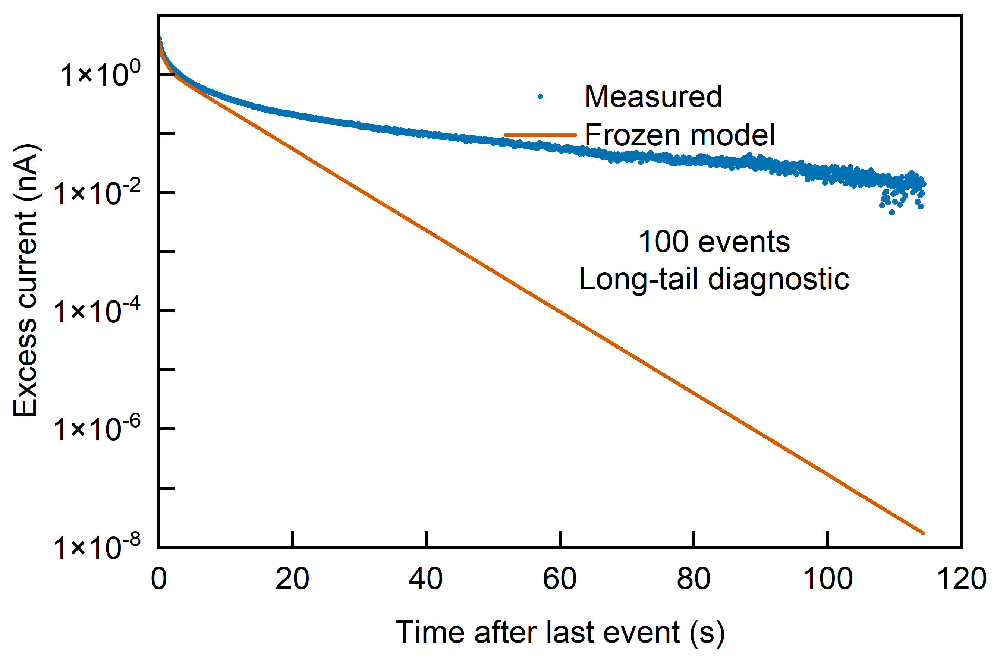
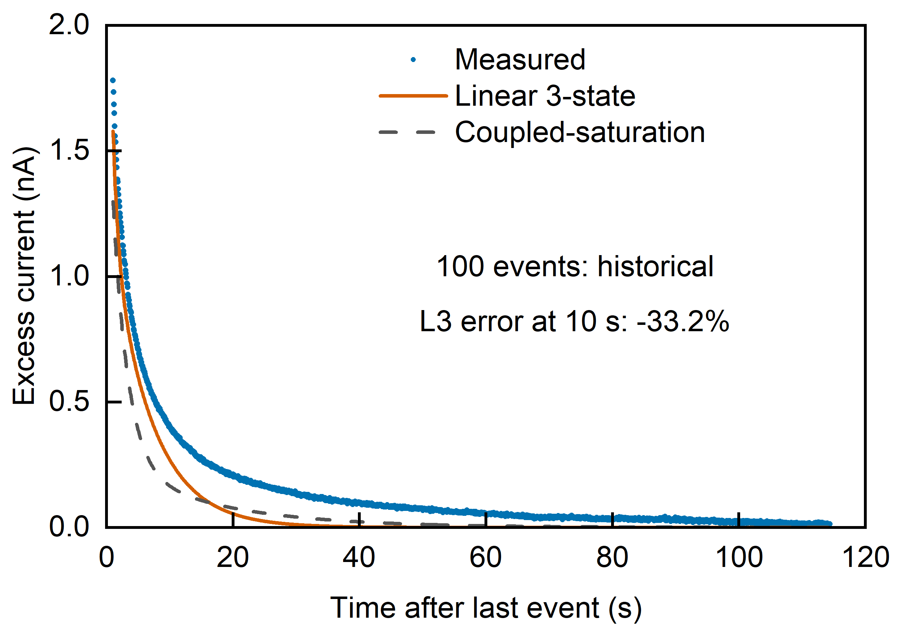
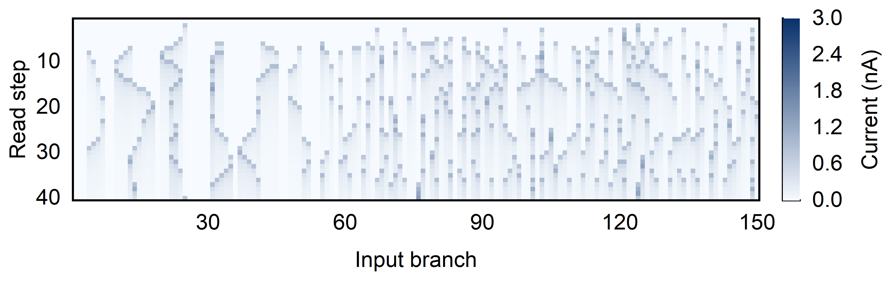

# EPSC 与十动作 RC：Origin 原生研究图库

[返回首页](../../README.md) · [公开数据与绘图设置](../../examples/research-gallery/figures.json) · [数据来源与哈希](../../examples/research-gallery/sources.json) · [原生核验记录](validation.json)

这组图来自此前已经完成的非拉伸器件分析和公开数据库 RC 仿真。作者将所选绘图数据公开，重新调用 Origin 统一版式。所有曲线、计数与电流状态沿用既有结果；本次没有重新拟合、训练分类器或挑选预测记录。实测散点、模型曲线和仿真状态分别说明。

## 七张图与下载

| 图 | 展示什么 | 下载 |
|---|---|---|
| 01 光照十动作混淆矩阵 | 光照器件模型 + Softmax，319 条公开动作记录的留出预测，逐行归一化 | [PNG](01_ten_actions_light.png) · [PDF](01_ten_actions_light.pdf) · [EMF](01_ten_actions_light.emf) · [OPJU](01_ten_actions_light.opju) |
| 02 暗态十动作混淆矩阵 | 相同公开记录与读取精度，暗态模型的分类混淆方向 | [PNG](02_ten_actions_dark.png) · [PDF](02_ten_actions_dark.pdf) · [EMF](02_ten_actions_dark.emf) · [OPJU](02_ten_actions_dark.opju) |
| 03 十次间隔刺激 EPSC | 已有光照实测电流与冻结模型重放，175 个读数 | [PNG](03_ten_pulse_response.png) · [PDF](03_ten_pulse_response.pdf) · [EMF](03_ten_pulse_response.emf) · [OPJU](03_ten_pulse_response.opju) |
| 04 同一四十次刺激下的光暗累积 | 两个冻结模型接受同一刺激序列，1039 个点 / 条件 | [PNG](04_light_dark_accumulation.png) · [PDF](04_light_dark_accumulation.pdf) · [EMF](04_light_dark_accumulation.emf) · [OPJU](04_light_dark_accumulation.opju) |
| 05 一百次刺激后的长尾 | 实测与最终冻结模型的恢复差异，对数纵轴，1577 个点 / 曲线 | [PNG](05_hundred_pulse_tail.png) · [PDF](05_hundred_pulse_tail.pdf) · [EMF](05_hundred_pulse_tail.emf) · [OPJU](05_hundred_pulse_tail.opju) |
| 06 储备池电流状态热图 | 40 个读取时刻 × 150 条输入支路，6000 个未量化模拟电流 | [PNG](06_reservoir_state_map.png) · [PDF](06_reservoir_state_map.pdf) · [EMF](06_reservoir_state_map.emf) · [OPJU](06_reservoir_state_map.opju) |
| 07 历史模型的恢复偏差 | 旧版 L3/C3 模型比较，1563 个点 / 曲线，约 10 s 的 L3 电流误差为 −33.2% | [PNG](07_historical_recovery_deviation.png) · [PDF](07_historical_recovery_deviation.pdf) · [EMF](07_historical_recovery_deviation.emf) · [OPJU](07_historical_recovery_deviation.opju) |








## 十个动作与归一化

矩阵行是真实动作，列是预测动作。每一格为该行计数除以该真实动作的记录总数，颜色与标签均为 0–1。**第 8 类有 31 条，其他类别各 32 条**，合计 319 条；不能把所有格子都除以 32。数值显示保留两位小数，原始计数和完整精度保存在数据与 OPJU 中。

| 编号 | 动作 | 记录数 |
|---|---|---:|
| 1 | 右臂向左划 | 32 |
| 2 | 右臂向右划 | 32 |
| 3 | 右手挥手 | 32 |
| 4 | 双手前拍 | 32 |
| 5 | 右臂投掷 | 32 |
| 6 | 胸前交叉双臂 | 32 |
| 7 | 投篮 | 32 |
| 8 | 右手画 X | 31 |
| 9 | 右手顺时针画圆 | 32 |
| 10 | 右手逆时针画圆 | 32 |

| 统计口径 | 光照 | 暗态 |
|---|---:|---:|
| 8 名留出受试者准确率的平均值 | 89.94% | 65.52% |
| 合并 319 条的准确率 | 287/319 = 89.97% | 209/319 = 65.52% |

这里使用最终 **Softmax** 读出结果，和早期 Ridge 图 23/24 的结果区分。外层按受试者留一测试，内层按受试者分组选择读出正则化；输入与特征标准化只使用训练记录。两条件使用相同 150 条固定编码支路、40 个时间段、6000 个读出特征，以及共享 0–3 nA 的双位读取仿真。完整流程和逐条公开预测见 [PhotoSynapse-RC](https://github.com/jiahehu2000-lgtm/photo-synapse-rc)。

## 怎样读 EPSC 与状态图

**十次刺激图**：蓝色点是已有器件实测，橙色线是固定参数模型按原刺激时刻重放的预测。属于此前校准条件的重放，绘图工具只展示已经提供的曲线。

**四十次累积图**：两条曲线都来自模型仿真。相同的 40 次单位事件、0.13906 s 间隔、零初始状态使它们可以直接比较。这里显示未量化电流；此演示刺激序列与具体动作的编码序列不同。

**一百次长尾图**：这组恢复记录此前没有参与器件模型拟合。纵轴使用对数，把全部已提供的正值绘图点和预测尾段显示出来，范围扩展到 10⁻⁸–10 nA。实测长尾明显高于预测，说明当前冻结模型未充分描述这个长时间恢复条件。全部 1577 个绘图点 / 曲线保留，不补造暗态 100 次记录。

**历史恢复偏差图**：实测和 L3/C3 曲线是此前的候选模型比较。最近 10 s 的实际读数时刻为 10.008392334 s，实测 0.402331820637 nA、L3 预测 0.268931240911 nA；相对误差 `(预测 − 实测) / 实测` 为 −33.1568553%，图内显示 −33.2%。这个数是电流预测误差，不能当成识别准确率，也不代表最终 RC 模型。

**电流状态图**：纵向是第 1 到 40 次读取，横向是 150 条输入支路。它展示固定器件模型产生的全部 6000 个电流状态，色标保留此前的 0–3 nA 范围。原始矩阵的第一行为列名 1–150，读取时跳过该行。

## 本地重绘

在完整仓库根目录、已安装 Skill 依赖且能调用 Origin 的 Windows 上运行：

```powershell
& ./.venv/Scripts/python.exe skills/origin-scientific-plotting/scripts/origin_plot.py --spec examples/research-gallery/figures.json --validate-only
& ./.venv/Scripts/python.exe skills/origin-scientific-plotting/scripts/origin_plot.py --spec examples/research-gallery/figures.json --output research-results --formats png,pdf,emf
```

`research-results` 必须为新目录或空目录。CSV 是原绘图数据的逐字节副本，来源清单记录 SHA-256；两张混淆矩阵和状态热图的完整数值也直接保存在规格 JSON 中。重新运行只绘图，不会下载数据库或训练模型。

本图库公开的是所选 EPSC 绘图数据与模型结果、公开动作任务的汇总计数，没有个人手机 / 手表原始记录。PDF / EMF 由 Origin 导出，OPJU 内含数值数据、原生图层与可编辑文字。版式与数值验证记录见 [validation.json](validation.json)。

绘图设置为 Arial 10 pt、1 pt 图框；原生页面按内容收紧，不扩大外侧白边。实际 PDF 导出宽度约 104.4–144.6 mm，PDF 常规文字度量约 10.08 pt，对数指数约 6.96 pt，均记录于核验文件。排版缩放后应按目标尺寸复查字号，这些尺寸不等同于某一期刊的官方栏宽。
